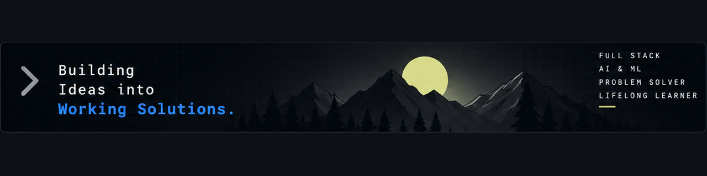

# Hi, I'm Piyush Dawkhare 👋

**Software Engineer | Full-Stack Development | Problem Solving**

I'm a Computer Science and Engineering student at Walchand College of Engineering, Sangli, with a strong foundation in data structures, algorithms, object-oriented programming, and software development.

I enjoy building reliable applications, designing REST APIs, working with databases, and exploring data analytics and machine learning. I've solved **500+ DSA problems** and gained practical software engineering experience through internships, projects, and collaborative development.

- 🔭 **I’m currently working on:** Building practical software applications and improving my software engineering skills.
- 🌱 **I’m currently learning:** Backend engineering, system design, and data analytics and machine learning.
- 👯 **I’m looking to collaborate on:** Full-stack applications, open-source projects, and meaningful software engineering projects.
- 🤔 **I’m looking for help with:** Scalable backend architectures, system design, and writing more maintainable code.
- 💬 **Ask me about:** Data structures and algorithms, C++, JavaScript, React, Node.js, REST APIs, and databases.
- 📫 **How to reach me:** [Email](mailto:piyushdawkhare0000@gmail.com) · [LinkedIn](YOUR_LINKEDIN_URL)
- ⚡ **Fun fact:** I've solved 500+ DSA problems and enjoy turning complex problems into practical solutions.

---

## 🛠️ Tech Stack

**Languages**

**Frontend & Backend**

**Databases & Cloud**

**Tools & Core Concepts**

**Also familiar with:** REST API design, authentication and authorization, role-based access control (RBAC), multithreading, memory management, Pandas, NumPy, and Scikit-learn.

---

## 🚀 Featured Projects

### 1. Mini-Drive — Cloud File Management

A cloud-based file management platform with a responsive dashboard and a Node.js API.

- Integrated Azure Blob Storage for file hosting and Firestore for real-time metadata management.
- Implemented secure, time-limited file access using Azure SAS tokens.
- Automated deployment workflows.

**Tech stack:** React.js · Node.js · Microsoft Azure · Firebase · Tailwind CSS

[View repository](YOUR_MINIDRIVE_REPOSITORY_URL)

### 2. PACE Website — Event & Club Platform

A responsive website for a college club, built to support student and faculty interactions.

- Developed a responsive React.js interface optimized for mobile devices.
- Implemented role-based access control using Firebase.
- Strengthened application security and user experience.

**Tech stack:** React.js · JavaScript · Tailwind CSS · Firebase

[View repository](https://github.com/INDJokerGamma/Pace-new-website)

### 3. OpenNest — Hackathon Finalist

A collaborative hackathon project focused on usability, onboarding, and user engagement.

- Developed the frontend and onboarding workflow.
- Created reusable UI components and consistent branding.
- Collaborated with a cross-functional team to reach the hackathon final round.

**Tech stack:** MERN · Gemini API · EmailJS · Google Analytics · GitHub Authentication

[View repository](YOUR_OPENNEST_REPOSITORY_URL)

---

## 🏆 Achievements

- Solved **500+ DSA problems** across coding platforms.
- Reached **2-Star Coder** status on CodeChef.
- Finalist at the SGU Hackathon with OpenNest.
- Finalist in the Aspire 2K23 competition.

---

## 💼 Experience & Leadership

**Software Engineering Intern — Rajiv Gandhi Science & Technology Commission (RGSTC)**

*June 2026 – August 2026*

- Built a full-stack platform to replace legacy Excel-based billing for industrial subcontracting dispatches.
- Implemented effective-date rate resolution, immutable rate snapshots, and an append-only audit log.
- Developed automated scrap calculations and JWT-based authentication with role-based access control.

**Co-Chief — Training & Placement Office, Walchand College of Engineering**

*October 2025 – Present*

- Coordinated placement activities and recruiter communication.
- Managed student communications to improve participation and streamline recruitment.

**Co-Lead — Microsoft Learn Students Community**

*June 2025 – December 2025*

- Led event planning and execution.
- Contributed to a 30% increase in average attendance across community events.

---

## 📈 GitHub Activity

---

## 🤝 Let's Connect

I'm interested in software engineering opportunities, collaborative projects, and learning from other developers.

*Build. Learn. Solve. Improve.*
